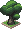
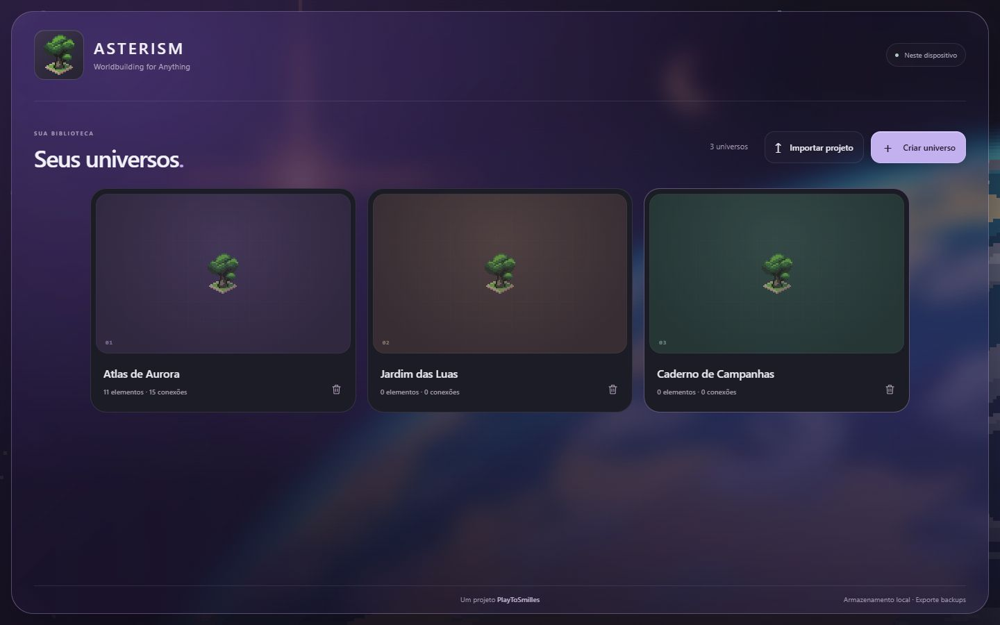
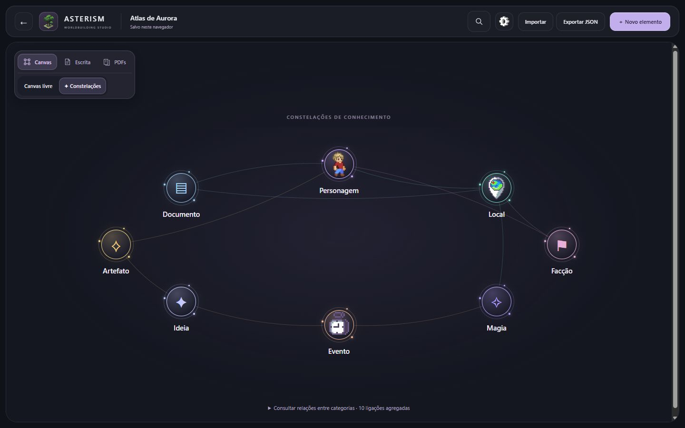
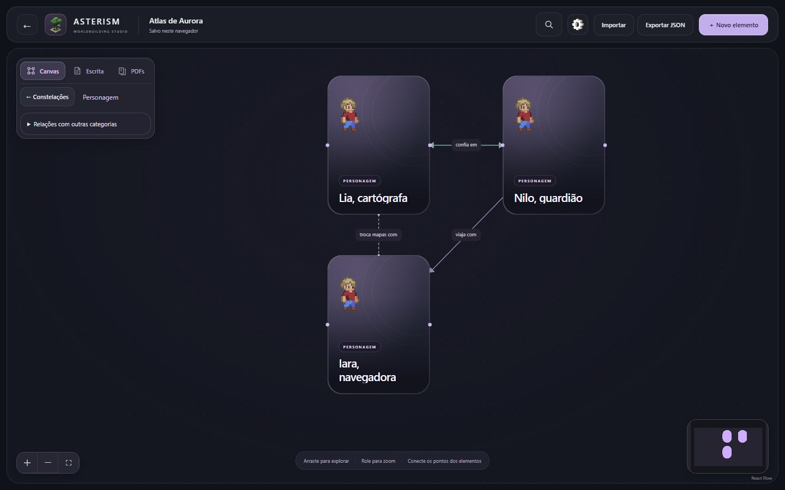
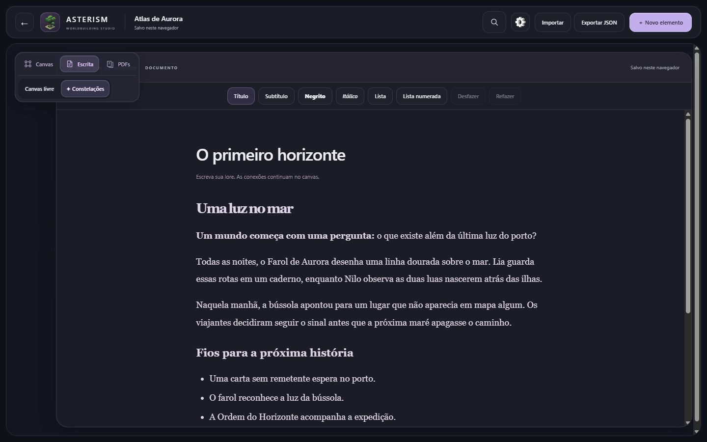

<p align="center">
  
</p>

<h1 align="center">ASTERISM</h1>
<p align="center"><strong>Worldbuilding for Anything</strong></p>
<p align="center">Crie universos. Conecte ideias. Explore mundos.</p>
<p align="center">
  <a href="https://asterism-164.pages.dev/"><strong>Experimente gratuitamente no navegador →</strong></a>
  · <a href="docs/ARCHITECTURE.md">Documentação técnica</a>
</p>

## Conheça o ASTERISM

Um ambiente visual de worldbuilding para escritores, criadores de histórias e mestres de RPG. Organize personagens, lugares, eventos, documentos e suas relações como **constelações de conhecimento** — para começar um universo ou dar forma às ideias que você já tem.



Sua biblioteca reúne os universos em um só lugar. Crie um projeto, reabra uma história ou importe um mundo que você já começou.

## Explore seus mundos

### Constelações de conhecimento

Veja o universo por categorias e descubra o que as conecta. Entre em uma constelação para explorar seus elementos, ou acompanhe a vizinhança de uma ideia.



### Canvas e relações

No Canvas livre, mova os elementos e construa suas conexões. Relações direcionais, recíprocas e associativas ajudam a expressar o significado de cada vínculo. Títulos, categorias e imagens opcionais por URL dão identidade aos cards.



### Um espaço para escrever

Desenvolva cenas, anotações e histórias no editor de Documentos, com títulos, listas, negrito e itálico. Conecte seus textos aos personagens e lugares do universo.



**Referências em PDF** ficam disponíveis em uma biblioteca do universo, com leitura integrada e opção de abrir separadamente. A **Busca Universal**, pela lupa ou por Ctrl/Cmd+K, encontra elementos, relações, textos dos Documentos e nomes dos PDFs — sem pesquisar o conteúdo interno dos arquivos PDF.

*As capturas mostram a interface real com conteúdo sintético criado para esta apresentação.*

## Seus mundos, seus dados

Comece sem criar conta. Os universos e seus Documentos são salvos no **LocalStorage do navegador**; os PDFs anexados ficam no **IndexedDB**. Não há backend de sincronização: outro navegador, perfil, endereço ou dispositivo terá um armazenamento separado.

Exporte backups regulares em JSON. O arquivo preserva elementos, relações, posições e textos autorais; a importação cria uma cópia independente. **O JSON não inclui os PDFs nem seus metadados** — guarde os originais ou baixe-os separadamente. Limpar os dados do navegador pode apagar seus universos e anexos.

Imagens por URL dependem dos serviços externos que as hospedam. O JSON guarda a referência, não os arquivos das imagens.

## Comece a usar

[Abrir o ASTERISM →](https://asterism-164.pages.dev/)

Use no navegador desktop ou mobile. O editor visual prioriza telas maiores; a interface móvel permite consultar e editar seu universo. Veja orientações no [guia de uso](docs/USER_GUIDE.md) e as limitações conhecidas em [PROJECT_STATUS](docs/PROJECT_STATUS.md).

## Executar localmente

Use **Node.js 24** e npm. Também são aceitos Node 22.12+ da linha 22 ou Node 26+.

```sh
npm ci
npm run dev
```

Abra o endereço exibido pelo Vite. Não é necessário configurar um arquivo de ambiente.

Para verificar o projeto:

```sh
npm test
npm run lint
npm run build
```

O build inclui a verificação TypeScript. Para consultar a versão gerada localmente, use `npm run preview`.

## Tecnologias

React, TypeScript strict e Vite na base da aplicação; React Flow no canvas e Tiptap na escrita. LocalStorage e IndexedDB mantêm os dados no navegador.

## Documentação

- [Guia de uso e desenvolvimento](docs/USER_GUIDE.md)
- [Estado do projeto e limitações](docs/PROJECT_STATUS.md)
- [Arquitetura e fluxo de dados](docs/ARCHITECTURE.md)
- [Histórico de mudanças](docs/CHANGELOG.md)
- [Decisões arquiteturais](docs/DECISIONS.md)
- [Regras para agentes e manutenção](AGENTS.md)

## PlayToSmilles

Um produto **PlayToSmilles**. Um espaço para dar forma aos seus mundos.
